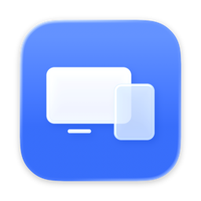

<p align="center"></p>

<h1 align="center">Annex</h1>

<p align="center">Use your Android phone or tablet as an extra display for your Mac — over USB or Wi-Fi.</p>

<p align="center"><a href="https://classroomadventure.github.io/ca-annex/">Website</a> · <a href="https://github.com/ClassroomAdventure/ca-annex/releases/latest">Download</a> · <a href="README.ja.md">日本語</a></p>

---

Annex works like Sidecar, but for Android. Your Mac sees a real second display: drag windows onto it, arrange it in Display Settings, and use touch or a stylus to click, drag and scroll.

- **USB or Wi-Fi.** Plug in a cable and it starts on its own, or pick your Mac from the list on the same Wi-Fi.
- **Low latency.** About 16 ms from capture to screen over Wi-Fi in our measurements. The pointer is drawn on the device, so it follows your finger with no delay.
- **Sharp.** Retina rendering at the device's native resolution, with larger and smaller size options.
- **Foldable-aware.** Fold, unfold or rotate and the Mac display resizes to match.
- **Any Android 8.0+ device.** Phones, tablets and foldables. HEVC is used when the device supports it.
- **Only your devices.** The first time a device connects over Wi-Fi, your Mac asks you to approve it and remembers your choice.

## Requirements

| | |
|---|---|
| Mac | macOS 14 Sonoma or later (Apple silicon or Intel) |
| Android | Android 8.0 or later |
| USB | [Android platform tools](https://developer.android.com/tools/releases/platform-tools) (`brew install android-platform-tools`) and USB debugging turned on |
| Wi-Fi | Mac and Android on the same network |

## Install

### Mac

1. Download `Annex-mac.zip` from [Releases](https://github.com/ClassroomAdventure/ca-annex/releases/latest), unzip it and move `Annex.app` to Applications. The app is signed and notarized by Apple, so it opens normally.
2. A setup guide opens on first launch. It walks you through **Screen Recording** (to send the screen) and **Accessibility** (for touch input), shows a QR code to download the Android app, and checks whether USB tools are installed. Annex then waits in the menu bar; reopen the guide from there any time.

### Android

1. Download `Annex-android.apk` from [Releases](https://github.com/ClassroomAdventure/ca-annex/releases/latest) on the device and install it.
2. For USB: turn on **Developer options → USB debugging**, connect the cable and allow the Mac when prompted.
3. Open Annex. Over USB it connects automatically; over Wi-Fi, tap your Mac in the list and choose **Allow** on the Mac the first time.

## Using it

| Gesture | On the Mac |
|---|---|
| Tap / double tap | Click / double-click |
| Drag with one finger | Drag |
| Long press or two-finger tap | Right-click |
| Two-finger swipe | Scroll (with momentum) |
| Stylus | Hover moves the pointer, touch to click, side button to right-click |
| Three-finger tap | Show latency statistics |

Move or rearrange the display in **System Settings → Displays**. It appears under the device's name.

## How it works

```
Mac   virtual display (CGVirtualDisplay) → ScreenCaptureKit → VideoToolbox HEVC/H.264 ──┐
                                                                                         │ USB: TCP via adb reverse
                                                                                         │ Wi-Fi: video over UDP, control over TCP
Android   MediaCodec hardware decode → full-screen SurfaceView ◀──────────────────────────┘
          touch / stylus → mouse & scroll events → Mac (CGEvent)
```

- The display exists only while a device is connected, like Sidecar.
- Over Wi-Fi, video is split into 1200-byte shards with one XOR parity shard per eight, so a single lost packet is repaired without retransmission. The device reports loss and network delay every 250 ms and the Mac adjusts the bitrate (3–30 Mbps).
- No periodic keyframes; when the screen stops changing, the same frame is re-encoded as a predicted frame to sharpen text without a bandwidth spike.
- The cursor is not baked into the video. The Mac sends its position and shape, and the device draws it — moving it immediately under your finger.

Measured on a Galaxy Z Fold with an M4 Pro MacBook Pro while the screen was moving:

| | Mac (capture + encode) | Network | Decode | Total |
|---|---|---|---|---|
| USB | ~7 ms | ~10 ms | ~3 ms | ~20 ms |
| Wi-Fi | ~7 ms | ~5 ms | ~3 ms | ~16 ms |

USB goes through `adb reverse`, which buffers continuous traffic; Wi-Fi is currently the faster path.

> **Note:** creating a virtual display uses `CGVirtualDisplay`, a private macOS API (also used by BetterDisplay, DeskPad and Chromium's tests). A future macOS update could break it.

## Building from source

```sh
# Mac app → mac/build/Annex.app
mac/build-app.sh

# Android app
cd android && ./gradlew installDebug   # needs JDK 17 and the Android SDK (platform 36)
```

`./dev.sh` builds both, restarts the Mac app and installs to a connected device. `ANNEX_DROP=0.03 ./dev.sh` drops 3% of Wi-Fi packets to test loss recovery. `Annex --bench-encoder 120` feeds synthetic frames to the encoder and prints latency with and without the in-flight limit (add `ANNEX_SLOW_ENCODE_MS=12` to simulate a slower Mac).

Release builds: `scripts/build-release.sh <version>` signs the Mac app with Developer ID, notarizes and staples it, and writes `dist/Annex-mac.zip`, `dist/Annex-android.apk` and `dist/Annex-android.aab`. The Android release key is not in the repository (see `.env.tpl`); without it, the APK is signed with the debug key.

The website lives in `docs/`. Edit `docs/src/page.html` (both languages in one file) and run `python3 scripts/build-pages.py` to regenerate `docs/index.html` and `docs/ja/index.html`; `scripts/render-og.sh` redraws the social preview images.

### Protocol

Every TCP message is `[type: u8][length: u32 BE][payload]`. Definitions live in `mac/Sources/Annex/Protocol.swift` and `android/app/src/main/java/com/classroomadventure/annex/Protocol.kt`.

## License

[MIT](LICENSE) © Classroom Adventure
